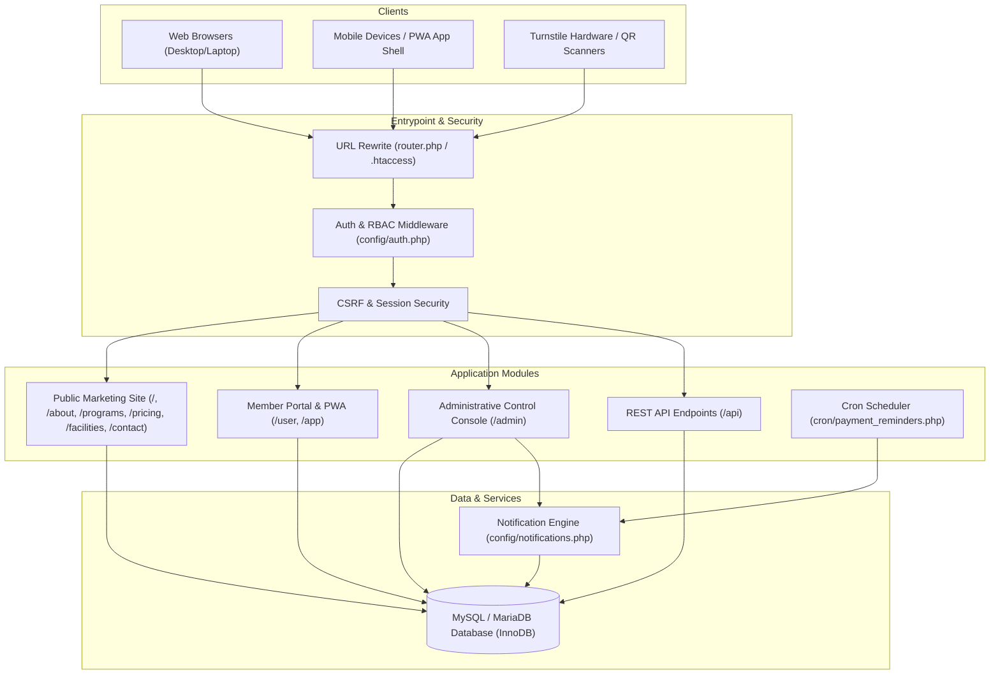
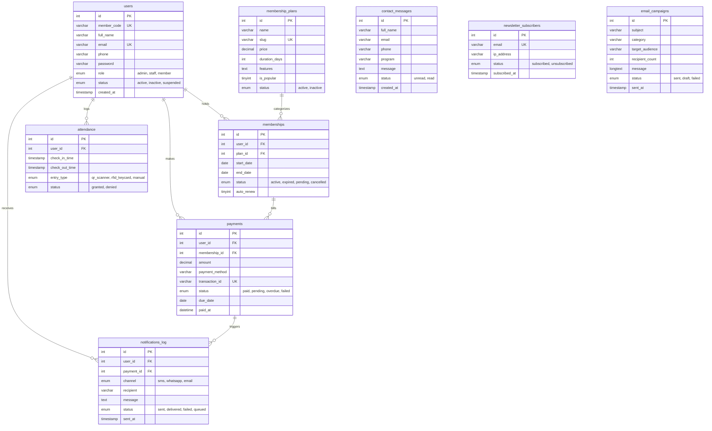

# GymFlow &mdash; Gym Management Portal & Ecosystem
## Complete Product Specification, Features & System Capabilities

---

> [!NOTE]
> **Product Name:** GymFlow (Gym Management Portal)  
> **Architecture:** Modular Monolithic MVC &bull; Native PHP 8.0+ &bull; MySQL / MariaDB (InnoDB) &bull; Tailwind CSS &bull; Progressive Web App (PWA)  
> **Currency Support:** Pakistani Rupee (PKR - ₨) &bull; Multi-channel local payment reconciliation (Cash, Credit/Debit Card, JazzCash, EasyPaisa, Bank Transfer)  
> **Target Audience:** Commercial Gyms, Fitness Clubs, CrossFit Boxes, Boutique Studios, and Personal Training Centers.

---

## 📋 Table of Contents
1. [Executive Summary & Product Mission](#1-executive-summary--product-mission)
2. [What This Product Does (Core Operational Scope)](#2-what-this-product-does-core-operational-scope)
3. [Target User Roles & Access Hierarchy](#3-target-user-roles--access-hierarchy)
4. [Comprehensive Feature Breakdown](#4-comprehensive-feature-breakdown)
   - [4.1 Public Marketing & Prospect Conversion Portal](#41-public-marketing--prospect-conversion-portal)
   - [4.2 Member Self-Service Portal (`/user`)](#42-member-self-service-portal-user)
   - [4.3 Mobile Progressive Web Application (`/app`)](#43-mobile-progressive-web-application-app)
   - [4.4 Administrative Command Center (`/admin`)](#44-administrative-command-center-admin)
   - [4.5 Billing, Invoicing & Cutoff Management](#45-billing-invoicing--cutoff-management)
   - [4.6 Attendance & Turnstile Access Control](#46-attendance--turnstile-access-control)
   - [4.7 Marketing & Broadcast Automation](#47-marketing--broadcast-automation)
   - [4.8 Automated Background Reminders & Cron System](#48-automated-background-reminders--cron-system)
   - [4.9 Headless REST API Gateway](#49-headless-rest-api-gateway)
5. [System Capabilities & Technical Highlights](#5-system-capabilities--technical-highlights)
   - [5.1 Performance & Resource Efficiency](#51-performance--resource-efficiency)
   - [5.2 Mobile & Offline Capabilities (PWA)](#52-mobile--offline-capabilities-pwa)
   - [5.3 Financial Accounting & Ledger Capabilities](#53-financial-accounting--ledger-capabilities)
   - [5.4 Multi-Channel Communication Capabilities](#54-multi-channel-communication-capabilities)
   - [5.5 Security & Defense-in-Depth Architecture](#55-security--defense-in-depth-architecture)
6. [System Architecture & Data Schema](#6-system-architecture--data-schema)
   - [6.1 High-Level Architecture Flowchart](#61-high-level-architecture-flowchart)
   - [6.2 Entity-Relationship Diagram (ERD)](#62-entity-relationship-diagram-erd)
7. [Default User Credentials & Directory Layout](#7-default-user-credentials--directory-layout)

---

## 1. Executive Summary & Product Mission

**GymFlow** is an enterprise-grade, all-in-one gym management platform and digital portal designed to modernize fitness facility operations. It eliminates fragmented paper logbooks, disconnected Excel spreadsheets, and expensive multi-vendor software subscriptions by consolidating all club operations into a single, high-performance ecosystem.

### The Problem It Solves:
* **Manual & Error-Prone Fee Collections:** Eliminates forgotten dues, unbilled renewals, and confusion over mid-month joined members through a strict, automated **10th-cutoff monthly billing system**.
* **Access Control Vulnerabilities:** Eliminates unpaid facility usage with live digital QR code turnstile access passes tied directly to subscription status.
* **Member Disengagement:** Keeps members motivated with automated consistency streak engines, workout counters, and instant direct access to dedicated fitness coaches via integrated WhatsApp and in-portal messaging.
* **Operational Blindspots:** Grants facility owners and managers real-time visibility into active headcount, daily turnstile check-ins, monthly recurring revenue, overdue receivables, and prospect conversion pipelines.

---

## 2. What This Product Does (Core Operational Scope)

GymFlow manages the complete lifecycle of a modern fitness enterprise from initial prospect awareness to ongoing member retention:


1. **Attracts & Captures Prospects:** Showcases gym facilities, specialized training programs (HIIT, Strength, Bodybuilding, Recovery), transparent membership packages priced in PKR, client testimonials, and interactive contact forms.
2. **Onboards & Manages Members:** Assigns unique, formatted member codes (e.g., `2026-1`, `2026-4`), stores profile and contact details, and maintains historical subscription records.
3. **Controls Facility Entry:** Generates cryptographic QR digital passes for members to scan at entrance turnstiles or mobile check-in kiosks, enforcing one check-in per day per member.
4. **Automates Invoicing & Payment Reconciliation:** Enforces recurring monthly dues on the 10th of every month, supports multi-channel cash desks (Cash, Card, JazzCash, EasyPaisa), tracks custom transaction identifiers, and logs audit notes.
5. **Drives Member Retention:** Measures training consistency streaks, counts monthly workouts, provides direct coaching support, and sends automated reminder alerts ahead of renewal deadlines.
6. **Delivers Administrative Intelligence:** Summarizes gross revenue, monthly receivables, overdue balances, member growth curves, and message inboxes in an intuitive dashboard.

---

## 3. Target User Roles & Access Hierarchy

GymFlow enforces a rigid **Role-Based Access Control (RBAC)** model across three distinct user categories:

| Role | Access Level | Primary Objectives & Available Modules |
| :--- | :--- | :--- |
| **System Administrator** | `admin` | Full control over the entire platform. Manages members, creates/edits membership pricing plans, processes billing transactions, executes broadcasts, views revenue metrics, and inspects system logs. |
| **Front Desk Staff / Coach** | `staff` | Operational floor management. Performs member check-ins, looks up member validity, uses quick "Mark as Paid" modals, handles customer inquiries, and conducts WhatsApp coaching interactions. |
| **Enrolled Gym Member** | `member` | Self-service convenience. Accesses digital turnstile QR pass, records daily workouts, tracks attendance streaks, views past payment invoices, and communicates with personal trainers. |
| **Unauthenticated Guest** | *None* | Discovers gym facilities, compares pricing tiers, reads training programs, subscribes to newsletter updates, and submits consultation forms. |

---

## 4. Comprehensive Feature Breakdown

### 4.1 Public Marketing & Prospect Conversion Portal
The public-facing portal is designed for high aesthetic impact and conversion:
* **Dynamic Landing Page ([`index.php`](file:///e:/Coding/GYM%20management%20system/index.php)):**
  * Modern athletic dark aesthetic utilizing Google Fonts (`Teko` uppercase headers and `Plus Jakarta Sans` body typography).
  * Real-time dynamic KPI metric counter showing active member tally, certified coaches, facility square footage, and modern equipment count.
  * Live-synced pricing tier preview pulling directly from the database with highlighted "Most Popular" badges.
  * Interactive transformation stories, member reviews, and instant newsletter capture.
* **Specialized Programs Page ([`programs.php`](file:///e:/Coding/GYM%20management%20system/programs.php)):**
  * Detailed breakdowns of training categories: HIIT, Heavy Strength & Hypertrophy, Functional Cross-training, and Athletic Mobility.
  * Intensity ratings, session durations, calories burned estimates, and coach assignments.
* **Facility & Amenities Tour ([`facilities.php`](file:///e:/Coding/GYM%20management%20system/facilities.php)):**
  * Visual overview of the Olympic lifting platform, cardio cinema, Finnish dry sauna, ice bath plunge pools, luxury locker rooms, and smoothie bar.
* **Transparent Pricing Matrix ([`pricing.php`](file:///e:/Coding/GYM%20management%20system/pricing.php)):**
  * Real-time plan cards (1 Month, 3 Months, 6 Months, or customized durations).
  * Feature check-lists, sauna access inclusion tags, guest pass allowances, and upfront pricing in Pakistani Rupee (PKR).
* **Interactive Contact & Lead Submission ([`contact.php`](file:///e:/Coding/GYM%20management%20system/contact.php)):**
  * Submits validated leads directly into the admin messages inbox with preferred program tagging.
  * Embedded Google Maps location, operating hours, direct phone dialing, and one-tap WhatsApp chat triggers.
* **Legal & Compliance:**
  * Dedicated terms of service ([`terms.php`](file:///e:/Coding/GYM%20management%20system/terms.php)) and privacy documentation ([`privacy.php`](file:///e:/Coding/GYM%20management%20system/privacy.php)).

---

### 4.2 Member Self-Service Portal (`/user`)
Located at [`user/index.php`](file:///e:/Coding/GYM%20management%20system/user/index.php), members get an interactive, mobile-optimized personal dashboard:
* **Live Digital Membership Pass:**
  * Real-time status badge (`Active`, `Expired`, `Pending Renewal`, `Suspended`).
  * Formatted Member Code (e.g., `2026-4`), registration date, and plan expiration countdown.
  * Real-time dynamic QR code generation encoded for turnstile optical scanners.
* **Turnstile Check-In & Consistency Engine:**
  * One-tap manual/QR check-in action directly from the dashboard.
  * Duplicate check-in prevention (enforces one valid check-in record per calendar day).
  * **Streak Calculation:** Dynamically counts consecutive training days to gamify consistency.
  * Monthly workout total calculator and chronological access history log.
* **Financial Billing & Invoices:**
  * Detailed overview of the current subscribed package and price.
  * Complete transaction history with system transaction IDs, payment methods, and receipt timestamps.

---

### 4.3 Mobile Progressive Web Application (`/app`)
Located at [`app/index.php`](file:///e:/Coding/GYM%20management%20system/app/index.php), GymFlow provides an app-store-free mobile application:
* **Native-App User Experience:**
  * Installable directly to iOS and Android home screens via [`manifest.json`](file:///e:/Coding/GYM%20management%20system/manifest.json) and [`sw.js`](file:///e:/Coding/GYM%20management%20system/sw.js).
  * Works offline by caching stylesheets, JavaScript assets, SVG icons, and Google Web Fonts.
  * App bottom tab bar for fast one-thumb navigation (Home, QR Pass, Coach Support, Profile).
* **Interactive Coach & Front Desk Hub ([`app/coach.php`](file:///e:/Coding/GYM%20management%20system/app/coach.php)):**
  * Selectable consultation topics: Custom Workout Regimen, Nutrition & Caloric Deficits, Membership Upgrades, Facility Inquiries.
  * One-tap **WhatsApp Deep Linking** that pre-populates structured text messages to the trainer's or front desk's direct WhatsApp line.
  * Redundant database logging ensuring support requests are archived in the admin inquiries inbox.

---

### 4.4 Administrative Command Center (`/admin`)
The management engine located in [`admin/`](file:///e:/Coding/GYM%20management%20system/admin/) gives administrators complete oversight:
* **Executive Metrics Dashboard ([`admin/index.php`](file:///e:/Coding/GYM%20management%20system/admin/index.php)):**
  * Real-time revenue analytics (Total Lifetime Revenue, Current Month Revenue, Pending Invoices).
  * Member counts (Total Registered, Active, Expiring within 7 Days, Overdue/Suspended).
  * Today's gym floor attendance headcount.
  * Quick-Action Modals for rapid on-the-fly member creation and instant payment logging without page reloads.
* **Member Directory & CRM ([`admin/members.php`](file:///e:/Coding/GYM%20management%20system/admin/members.php)):**
  * Dynamic multi-parameter search (Name, Member Code, Email, Phone Number).
  * Status filtering (`active`, `inactive`, `suspended`) and plan filtering.
  * Automatic sequential member code allocation (e.g., `2026-1`, `2026-2`, etc.).
  * Dedicated Member Creation ([`admin/members-add.php`](file:///e:/Coding/GYM%20management%20system/admin/members-add.php)) and Member Editing ([`admin/members-edit.php`](file:///e:/Coding/GYM%20management%20system/admin/members-edit.php)) interfaces.
  * Instant "Mark as Paid" desk modal to quickly renew or reconcile member fees.
* **Dynamic Plan Builder ([`admin/plans.php`](file:///e:/Coding/GYM%20management%20system/admin/plans.php)):**
  * Full CRUD for membership packages (Plan Name, Slug, Price in PKR, Duration in Days).
  * JSON-encoded bullet point management for plan perks.
  * "Is Popular" promotion toggles that automatically update the public marketing site cards.
* **Customer Inquiry Inbox ([`admin/messages.php`](file:///e:/Coding/GYM%20management%20system/admin/messages.php)):**
  * Central inbox aggregating public contact form messages and mobile app coach inquiries.
  * Read/unread state flags, spam deletion, and one-click direct email or WhatsApp replies.

---

### 4.5 Billing, Invoicing & Cutoff Management
Located at [`admin/billing.php`](file:///e:/Coding/GYM%20management%20system/admin/billing.php) and [`admin/payments.php`](file:///e:/Coding/GYM%20management%20system/admin/payments.php):
* **Strict 10th-Cutoff Monthly Billing Cycle:**
  * Implements commercial fitness industry best-practices where fees are billed and renewed on the 10th of every month.
  * Overdue calculation logic with visual amber/red warning badges for defaulted accounts.
* **Multi-Channel Local Payment Reconciliation:**
  * Supports Cash, Credit/Debit Cards, JazzCash, EasyPaisa, and Direct Bank Transfers.
  * Assigns unique audit transaction IDs (e.g., `TXN-87412-A101` or `TXN-FD-XXXX`).
  * Keeps full audit notes for cashier verification and shift handovers.

---

### 4.6 Attendance & Turnstile Access Control
Located at [`admin/attendance.php`](file:///e:/Coding/GYM%20management%20system/admin/attendance.php) and [`api/attendance.php`](file:///e:/Coding/GYM%20management%20system/api/attendance.php):
* **Hardware & Kiosk Integration Foundation:**
  * Supports entry methods: `qr_scanner`, `rfid_keycard`, and front-desk `manual` override.
  * Real-time verification: Checks whether member status is `active` and expiry date is valid before granting access (`granted` vs `denied`).
  * Front desk can toggle the visual turnstile scanning kiosk on and off as needed.

---

### 4.7 Marketing & Broadcast Automation
Located at [`admin/newsletter.php`](file:///e:/Coding/GYM%20management%20system/admin/newsletter.php) and [`api/subscribe.php`](file:///e:/Coding/GYM%20management%20system/api/subscribe.php):
* **Newsletter Subscriber Directory:**
  * Stores subscriber email addresses, opt-in timestamps, and originating client IP addresses.
  * Handles duplicate email prevention and auto-reactivation.
* **Email Broadcast & Campaign Management:**
  * Compose and dispatch announcements, holiday operating hours, or promotional discounts to all active members or newsletter leads.
  * Archives campaign history and delivery counts in `email_campaigns`.

---

### 4.8 Automated Background Reminders & Cron System
Located at [`cron/payment_reminders.php`](file:///e:/Coding/GYM%20management%20system/cron/payment_reminders.php) and configured in [`config/notifications.php`](file:///e:/Coding/GYM%20management%20system/config/notifications.php):
* **Automated Expiry & Overdue Detection:**
  * Scans database daily for memberships expiring within 3 days, expiring today, or overdue past the 10th cutoff.
* **Dynamic Template Substitution:**
  * Merges recipient details into personalized copy: `{{member_name}}`, `{{amount}}`, `{{due_date}}`, and `{{payment_url}}`.
* **Multi-Gateway Ready:**
  * Pre-wired abstractions for SMS Gateways and WhatsApp Business APIs.
  * Complete audit trail in `notifications_log` to prevent double-messaging.
* **Multiple Execution Modes:**
  * CLI execution: `php cron/payment_reminders.php`
  * System Crontab: `0 8 * * * /usr/bin/php /path/to/gymflow/cron/payment_reminders.php`
  * Webhook / External Cron Trigger: `https://yourdomain.com/cron/payment_reminders.php?token=GYMFLOW_CRON_SECRET`

---

### 4.9 Headless REST API Gateway
Located in [`api/`](file:///e:/Coding/GYM%20management%20system/api/):
* **Dynamic Plan Discovery ([`api/index.php?action=plans`](file:///e:/Coding/GYM%20management%20system/api/index.php)):** Returns active membership tiers with pricing and decoded feature lists in JSON.
* **Member Status Verification ([`api/index.php?action=member_status`](file:///e:/Coding/GYM%20management%20system/api/index.php)):** Validates member codes for turnstile hardware scanners.
* **Public Lead Capture ([`api/subscribe.php`](file:///e:/Coding/GYM%20management%20system/api/subscribe.php)):** AJAX endpoint for rapid newsletter subscriptions with CSRF protection.

---

## 5. System Capabilities & Technical Highlights

### 5.1 Performance & Resource Efficiency
* **Zero Framework Overhead:** Built on native modern PHP 8.0+, executing with sub-50ms response times and requiring less than 8MB RAM per request.
* **Database Singleton Pattern:** Employs a persistent PDO singleton instance ([`config/database.php`](file:///e:/Coding/GYM%20management%20system/config/database.php)) preventing connection leakages and ensuring transaction isolation.
* **Indexed InnoDB Storage:** All foreign keys and query lookups (email, status, dates, roles) are indexed for lightning-fast retrieval even with tens of thousands of records.

### 5.2 Mobile & Offline Capabilities (PWA)
* **Installable PWA Manifest:** Full web app manifest with standalone display mode, athletic brand theme colors, and multi-size icon definitions.
* **Custom Service Worker (`sw.js`):** Implements a cache-first strategy for static assets (CSS, images, icons, fonts) and a network-first strategy for dynamic member data.
* **Native-Feeling Navigation:** Fixed thumb-friendly bottom bar optimized for mobile browsers, eliminating browser chrome when installed.

### 5.3 Financial Accounting & Ledger Capabilities
* **Strict Currency Representation:** Dedicated `DECIMAL(10, 2)` schema types prevent rounding errors inherent in floating-point math.
* **Pakistani Rupee Localization:** Tailored specifically for Pakistan's payment ecosystem with out-of-the-box support for JazzCash and EasyPaisa tracking alongside cash and cards.
* **Unforgeable Reference IDs:** Automated generation of distinct transaction sequences for audit trails and physical receipt cross-referencing.

### 5.4 Multi-Channel Communication Capabilities
* **WhatsApp Deep Links:** Instant generation of URI schemes (`https://wa.me/...`) enabling direct mobile conversations between coaches and members without expensive SMS gateway costs.
* **Multi-Gateway SMS Abstraction:** Configurable SMS dispatch ready for local telco aggregators.
* **Email Dispatch Engine:** Standard SMTP/PHP Mailer integration for campaign broadcasts and password resets.

### 5.5 Security & Defense-in-Depth Architecture
* **Bcrypt Password Encryption:** State-of-the-art password hashing using `PASSWORD_BCRYPT` with cost factor 10.
* **Universal CSRF Protection:** Cryptographically secure CSRF tokens embedded in all forms and validated on every mutating HTTP POST request.
* **SQL Injection Immunity:** 100% of database interactions execute via PDO prepared statements with explicit parameter binding.
* **XSS Neutralization:** All dynamic user output is sanitized using context-aware `htmlspecialchars(..., ENT_QUOTES, 'UTF-8')`.
* **Hardened Session Management:** Session cookies configured with `HttpOnly`, `SameSite=Lax`, strict HTTPS flags, and automated ID regeneration upon authentication to prevent session fixation.

---

## 6. System Architecture & Data Schema

### 6.1 High-Level Architecture Flowchart



---

### 6.2 Entity-Relationship Diagram (ERD)

GymFlow's relational database consists of 9 core tables structured with strict foreign key constraints:



---

## 7. Default User Credentials & Directory Layout

### 7.1 Pre-Seeded Default Accounts

| Role | Email | Password | Access URL | Primary Scope |
| :--- | :--- | :--- | :--- | :--- |
| **Super Admin** | `admin@gymflow.com` | `Admin123!` | `/admin/` | Complete platform administration & financials |
| **Front Desk Staff** | `staff@gymflow.com` | `Staff123!` | `/admin/` | Front desk check-in, member CRM & desk payments |
| **Enrolled Member** | `member@gymflow.com` | `Member123!` | `/user/` or `/app/` | Personal turnstile pass, streaks, billing history |
| **Enrolled Member** | `moeezahmad.tech@gmail.com` | `password123` | `/user/` or `/app/` | Personal turnstile pass, streaks, coach chat |

---

### 7.2 Directory Organization

```
GYM management system/
├── admin/                  # Administrative Console
│   ├── index.php           # Financial & Operational KPI Dashboard
│   ├── members.php         # Member Directory & Status Filter
│   ├── members-add.php     # Manual Member Onboarding
│   ├── members-edit.php    # Member Profile & Subscription Editor
│   ├── billing.php         # 10th-Cutoff Billing Ledger & Invoice Management
│   ├── payments.php        # Transaction Ledger & Payment Receipts
│   ├── plans.php           # Dynamic Membership Plan CRUD
│   ├── attendance.php      # Turnstile Access & Hardware Status
│   ├── messages.php        # Unified Inquiries & Support Inbox
│   ├── newsletter.php      # Newsletter Subscribers & Email Campaigns
│   └── reminders.php       # Automated Reminder Status Console
├── api/                    # Headless JSON REST Gateways
│   ├── index.php           # Dynamic Plan & Member Status Endpoints
│   ├── subscribe.php       # Newsletter Lead Capture Endpoint
│   └── attendance.php      # Hardware Turnstile Verification Endpoint
├── app/                    # Standalone Mobile Progressive Web App (PWA)
│   ├── index.php           # Mobile Member Dashboard & Quick QR Access
│   ├── coach.php           # Trainer Support & WhatsApp Bridge
│   ├── manifest.json       # PWA Application Manifest
│   └── sw.js               # Service Worker for Offline Assets
├── assets/                 # Static Assets (CSS, JS, Fonts, Images)
├── components/             # Reusable UI Partials (Header, Footer, Admin Nav)
├── config/                 # Core Infrastructure & Business Services
│   ├── app.php             # Global URL, Date & Currency Formatters
│   ├── auth.php            # RBAC Middleware, Session Guard & CSRF Tokens
│   ├── database.php        # PDO Database Singleton Wrapper
│   └── notifications.php   # SMS, WhatsApp & Email Template Engine
├── cron/                   # Automated Background Daemons
│   └── payment_reminders.php # Daily Expiry & Overdue Reminder Daemon
├── docs/                   # Exhaustive Technical Documentation Index
├── user/                   # Desktop Member Self-Service Portal
│   └── index.php           # Member Turnstile Pass, Streaks & Invoices
├── index.php               # Public Brand Homepage
├── about.php               # Gym Mission, History & Coaches
├── programs.php            # Training Programs & Schedule
├── facilities.php          # Equipment & Amenities Showcase
├── pricing.php             # Membership Pricing Matrix in PKR
├── contact.php             # Interactive Inquiry Form & Map
├── login.php               # Unified Authentication Gateway
├── logout.php              # Secure Session Teardown
├── router.php              # Local PHP Server Development Router
└── schema.sql              # Complete Relational Database Schema & Seeds
```

---

> [!TIP]
> **Summary Statement:** GymFlow provides fitness business owners with an enterprise-level system that automates lead capture, turnstile entry, recurring cutoff billing in PKR, consistency streak tracking, and coach communications—delivered through an ultra-fast, framework-free native PHP and PWA web platform.

