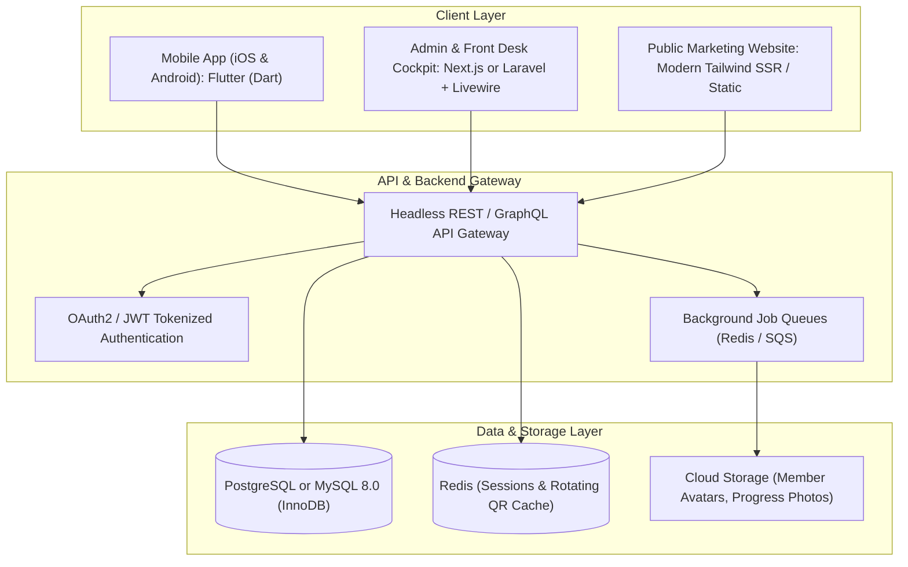
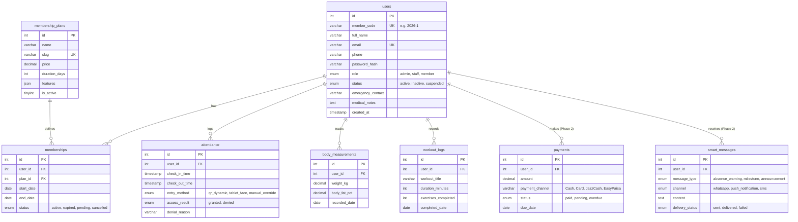

# GymFlow &mdash; Intelligent Gym Operating System (IaaS)
## Core System Architecture, Phased Roadmap, Remote Biometrics Strategy & Engineering Specification

> **Document Type:** Master Product & Engineering Blueprint  
> **Target Audience:** Product Managers, Software Architects, Full-Stack Engineers, AI Coding Assistants  
> **Platform Classification:** Intelligence-as-a-Service (IaaS) for Fitness & Athletic Centers  

---

## 1. Executive Vision: Intelligence-as-a-Service (IaaS)

GymFlow is evolving from a standalone web script into a comprehensive **Intelligence-as-a-Service (IaaS)** operating platform. 

### What Does "IaaS" Mean for a Gym?
Traditional gym software is merely a passive database: it holds records until a human manually types in a query. GymFlow as an **Intelligence-as-a-Service** platform actively monitors gym health and operates autonomously:
1. **Intelligent Churn Prediction & Retention Alerts:** Detects attendance drop-offs (e.g., a member who attended 4x/week dropping to 0 visits over 10 days) before they cancel.
2. **Autonomous Gate & Capacity Intelligence:** Automatically calculates gym floor peak hours, real-time headcounts, and turnstile access validity.
3. **Decoupled Phased Implementation:** Engineered to scale incrementally without operational bloat, separating MVP necessities from advanced automation.

---

## 2. Phased Product Roadmap

To guarantee rapid deployment and rock-solid stability, development is divided into distinct, structured phases:

```
┌─────────────────────────────────────────────────────────────────────────────┐
│                       GYMFLOW ROADMAP MILESTONES                           │
└─────────────────────────────────────────────────────────────────────────────┘
                                  │
    ┌─────────────────────────────┴─────────────────────────────┐
    ▼                                                           ▼
┌───────────────────────────────────────┐   ┌───────────────────────────────────────┐
│     PHASE 1: THE CORE PLATFORM        │   │    PHASE 2: INTELLIGENCE & SCALE      │
│          (CURRENT FOCUS)              │   │           (FUTURE ROLLOUT)            │
├───────────────────────────────────────┤   ├───────────────────────────────────────┤
│ • Complete Member Management CRM      │   │ • Automated 10th-Cutoff Billing Engine│
│ • Executive Admin Management Portal   │   │ • Multi-Channel Payments (Cash/Card/  │
│ • Dedicated Member Mobile Application │   │   JazzCash/EasyPaisa)                 │
│ • Remote-First QR Attendance System   │   │ • AI-Driven Member Messaging Engine   │
│ • Streak Engine & Workout History     │   │   (Smart WhatsApp & Push Alerts)      │
│ • Dynamic Plan CRUD & Staff Roles     │   │ • Contactless Tablet Face Recognition │
└───────────────────────────────────────┘   └───────────────────────────────────────┘
```

### Phase 1: Core Foundation (Active Scope)
* **Member Management Engine:** Profile CRUD, sequential alphanumeric member codes (e.g. `2026-1`), plan assignments, emergency contacts, medical notes, and status flags (`active`, `inactive`, `suspended`).
* **Admin Operations Portal:** Clean management console for gym owners and front-desk staff. Fast multi-parameter search, attendance monitoring, package builder, and employee role access control.
* **Member Mobile Application (User Side):** High-performance app providing digital turnstile access passes, attendance logs, workout consistency streaks, facility schedules, and profile management.
* **Remote-Manageable Attendance System:** Dynamic QR validation that operates friction-free without requiring onsite hardware technicians.

### Phase 2: Future Expansion (Upcoming Scope)
* **Automated Payment & Invoicing Hub:** 10th-cutoff billing workflows, automated invoice generation, payment status ledgers (`paid`, `pending`, `overdue`), receipt PDF generation, and local Pakistani gateway integrations (JazzCash, EasyPaisa, Debit/Credit cards, cash registers).
* **Automated Member Messaging & Alerts Engine:** Intelligent broadcast and direct messaging system. Automatically alerts active members about announcements and reaches out to absent or inactive members to prevent churn via WhatsApp Business API and push notifications.
* **Advanced Biometrics Kiosk:** Contactless face-recognition attendance running on standard commercial tablets mounted at reception.

---

## 3. Remote Attendance & Biometric Strategy: Comprehensive Evaluation

As a **remote software company**, managing physical hardware on client gym premises poses critical operational risks. Below is an engineering evaluation of the options:

### 3.1 Comparison Matrix of Attendance Technologies

| Criteria | 1. Physical Thumb / Fingerprint Scanner | 2. Proprietary Face Recognition Hardware | 3. Remote-First Dynamic Mobile QR Pass | 4. Front-Desk Tablet Camera Face AI |
| :--- | :--- | :--- | :--- | :--- |
| **Remote Deployability** | ❌ **Extremely Poor.** Requires static IPs, USB/RS485 drivers, local port forwarding, and local server setup. | ⚠️ **Challenging.** Closed vendor firmware, proprietary cloud bridges, complex onsite troubleshooting. | 🟢 **Exceptional.** 100% cloud-managed; zero local drivers or network configuration needed. | 🟢 **High.** Uses standard Android/iPad tablet with front camera via browser/Flutter app. |
| **Maintenance Burden** | ❌ High. Dirty sensors, dry skin failures, sensor calibration errors require physical visits. | ⚠️ Moderate. Lens cleaning, camera alignment, lighting interference. | 🟢 Minimal. Runs on member's personal smartphone; zero moving hardware parts. | 🟢 Low. Software updates pushed over-the-air (OTA); standard tablet replacement. |
| **Proxy / Buddy Punching Prevention** | 🟢 High. Biological fingerprint required. | 🟢 High. Live facial biological verification. | 🟢 **High (with Time-Based Rotating QR + Geofence).** Screenshots expire every 15-30s. | 🟢 High. Real-time liveness detection and face matching. |
| **Initial Hardware Cost for Gym** | $150 – $400 per scanner + wiring costs. | $400 – $1,200 per specialized terminal box. | **$0** (Or $30 for a basic 2D optical scanner at desk). | $100 – $200 (Any standard budget Android tablet). |
| **Implementation Speed** | 2 to 4 weeks of physical installation. | 2 to 3 weeks of vendor hardware onboarding. | **Immediate (Instant Remote Onboarding).** | 1 to 2 days (Download app on tablet). |

---

### 3.2 Strategic Recommendation for a Remote Company

> [!IMPORTANT]
> **Why Physical Fingerprint/Thumb Scanners Are a Trap for Remote Teams:**  
> When a thumb scanner fails in a gym 500 miles away due to a dropped COM port, Windows driver crash, or greasy glass plate, your remote team cannot fix it without sending a technician. This leads to frustrated gym owners and contract cancellations.

#### The Recommended 2-Tier Strategy:

#### Tier 1 (Immediate / Primary): Time-Based Rotating QR + Geofencing
1. **How it Works:** The member opens the GymFlow Mobile App on their phone.
2. The app displays a dynamic **TOTP-style QR Code** that regenerates every 20 seconds (preventing members from taking a screenshot and sending it to an unpaid friend).
3. The front desk has either:
   * A cheap $25 2D USB optical barcode scanner plugged into the front-desk PC, OR
   * A budget Android tablet mounted on a stand facing the entrance, displaying a "Scan Your Pass" camera view.
4. **Offline Capability:** Using time-based algorithmic tokens (HMAC/SHA256), the code can be validated offline even when the gym's internet fluctuates.
5. **Geofencing Safety:** Optional GPS check ensuring the member's device is within 100 meters of the gym facility.

#### Tier 2 (Future Phase): Contactless Tablet Camera Face Kiosk
1. Mount a standard Android tablet or iPad at the front desk with GymFlow's Kiosk App running.
2. As members walk up, the front camera detects the face using lightweight on-device ML (e.g. MediaPipe / Google ML Kit) and matches against the stored member profile photo.
3. Completely software-driven—if a tablet breaks, the gym owner buys any standard tablet from a local electronics store, logs in, and it works immediately. Zero proprietary hardware dependencies!

---

## 4. Mobile App Feature Bundle (User Side)

To make the GymFlow Member App indispensable and drive daily member engagement, it incorporates an extensive feature bundle:

### 4.1 Attendance & Access Control
* **Dynamic Turnstile Pass:** Self-refreshing QR pass with clear status badges (`Active`, `Suspended`, `Renewal Due`).
* **Attendance History Calendar:** Interactive monthly calendar view highlighting days attended, rest days, and total gym hours logged.
* **Streak & Consistency Engine:** Gamified badges for consecutive workout days (e.g., "7-Day Streak", "20 Workouts This Month") with social sharing capabilities.

### 4.2 Training & Intelligent Workouts
* **Personalized Workout Library:** Access assigned gym programs (HIIT, Strength, Hypertrophy, Cardio) with exercise video tutorials and set/rep logs.
* **Digital Workout Logger:** Record daily weights lifted, sets completed, and personal records (PRs) per exercise.
* **Rest Timer & Audio Cue:** Built-in stopwatch between sets.

### 4.3 Transformation & Body Analytics
* **Body Metrics Tracker:** Log weight, body fat %, chest, waist, and biceps measurements over time with interactive trend graphs.
* **Private Progress Vault:** Secure, encrypted before-and-after photo storage to visually observe body transformations.

### 4.4 Facility & Trainer Engagement
* **Real-Time Gym Occupancy Meter:** Live indicator showing current gym floor traffic ("Quiet", "Moderate", "Peak Rush") so members can plan visits.
* **Class & Slot Reservations:** Book spots in high-demand group sessions (Spinning, CrossFit, Yoga, Boxing).
* **Direct Coach Chat & WhatsApp Bridge:** One-tap messaging to assigned personal trainers for guidance and encouragement.
* **Digital Bulletin Board:** Gym announcements, holiday hours, and special event notices.

---

## 5. Technology Stack & Framework Recommendations

### Current State: Native PHP 8.0 + MySQL + PWA
* *Current Pros:* Extremely fast execution, sub-15ms response times, zero framework bloat, simple hosting.
* *Current Limitations:* Progressive Web Apps (PWAs) on iOS suffer from restricted background sync, unreliable native push notifications, and inability to directly access low-level camera biometrics or Bluetooth hardware. Building an enterprise IaaS platform in vanilla PHP requires reinventing wheels for background job queues, websockets, and API versioning.

---

### The Recommended Modern Framework Architecture



### 5.1 Mobile App Framework Recommendation

#### 🏆 Top Recommendation: **Flutter (Dart)**
* **Why Flutter is the Best Choice for GymFlow:**
  1. **Single Unified Codebase:** Compiles to true native ARM code for both iOS and Android with 60fps/120fps fluid performance.
  2. **Superior Hardware & Camera Control:** Direct access to device hardware for camera-based QR scanning, biometric authentication (Face ID / Touch ID on device), and offline SQLite caching.
  3. **Reliable Background Push Notifications:** Full compatibility with Firebase Cloud Messaging (FCM) on both iOS and Android—essential for sending member notifications even when the app is closed.
  4. **Rapid UI Development:** Flutter's rich widget system makes crafting dark-mode athletic interfaces effortless.
* *Alternative Option:* **React Native (Expo)** — Excellent if your development team already has strong JavaScript/React expertise.

---

### 5.2 Website & Backend Framework Recommendation

Depending on your team's existing technical strengths, choose between these two production-proven architectures:

#### Option A (Best for PHP Teams / Fast Migration): **Laravel 11 + Livewire 3 / Inertia.js**
* **Why Choose Laravel:**
  * **Seamless Evolution from Native PHP:** Reuses existing business logic and MySQL schema effortlessly without learning a completely new backend language.
  * **Built-In Enterprise Features:** Includes user authentication, RBAC, background job queues (`Queue`), scheduled tasks (`Cron`), and REST API authentication (`Sanctum`) out of the box.
  * **Livewire 3:** Provides modern, reactive single-page app (SPA) responsiveness for the Admin Portal without the complexity of managing separate frontend build pipelines.

#### Option B (Best for Pure Modern Cloud SaaS): **Next.js 14/15 (TypeScript) + Node.js / NestJS + Supabase / PostgreSQL**
* **Why Choose Next.js:**
  * **Ultimate SaaS Developer Experience:** Full-stack TypeScript from frontend to database schemas.
  * **High-Speed Public Marketing:** Server-Side Rendering (SSR) and Incremental Static Regeneration (ISR) deliver unbeatable SEO rankings and sub-second page loads.
  * **Real-Time Websockets:** Built-in support for live subscription streams, ideal for turnstile entry events and instant headcount counters.

---

## 6. Database Architecture Specification (Phase 1 & Phase 2)



---

## 7. Current Implementation Specs & Live Code Inventory (Zero-Impact Baseline)

To ensure ongoing development does **not impact or break any current features**, the full specifications of the live application as currently running are cataloged below:

### 7.1 Live File Mapping & Directory Architecture
* **Public Showcase Layer:**
  * `index.php`: High-energy dark landing page (`Teko` + `Plus Jakarta Sans`), live KPI counters, MySQL package tiers in PKR, and newsletter subscription form.
  * `about.php`: Gym mission, philosophy, safety guidelines, and trainer roster (Marcus Vance, Elena Rostova, David Kim, Sarah Jenkins).
  * `programs.php`: Training catalog (HIIT, Hypertrophy, Boxing, Functional Mobility) with intensity meters and calorie burn estimates.
  * `facilities.php`: Visual facility tour (Olympic platforms, Finnish saunas, cold plunge tubs, cardio cinema, recovery zones).
  * `pricing.php`: Transparent membership tier cards (1-Month, 3-Month, 6-Month) with bullet perk checklists.
  * `contact.php`: Contact lead capture form with program dropdown, Google Maps embed, and direct WhatsApp links.
  * `login.php`: Unified login portal supporting Admin, Staff, and Member roles with CSRF protection and session fixation defense.
  * `logout.php`: Session destruction and redirect handler.
  * `terms.php` & `privacy.php`: Regulatory terms of service and member privacy policies.

* **Member Self-Service Portal (`/user`):**
  * `user/index.php`: Responsive member portal displaying digital turnstile pass with member code (e.g. `2026-4`), 1-click check-in button with duplicate check-in prevention (1 check-in per day), consistency streak counter, monthly workout tracker, attendance history log, and past payment receipt ledger.

* **Progressive Web App (`/app`):**
  * `app/index.php`: Mobile-first dashboard with bottom navigation bar (Home, QR Pass, Coach Support, Account) and dynamic QR pass.
  * `app/coach.php`: Coach consultation form with pre-filled WhatsApp deep-linking for direct trainer support.
  * `manifest.json`: PWA configuration enabling home screen installation on iOS and Android.
  * `sw.js`: Service worker caching static assets (CSS, fonts, icons) for offline app shell loading.

* **Administrative Command Suite (`/admin`):**
  * `admin/index.php`: Executive analytics cockpit with lifetime revenue, current month revenue, pending receivables, active headcount, and quick-add modals.
  * `admin/members.php`: Member directory with search by Name, Phone, Email, Member Code, status filters (`active`, `inactive`, `suspended`), and 1-click "Mark as Paid" modal.
  * `admin/members-add.php`: New member onboarding form with sequential member code generator (e.g., `2026-1`, `2026-2`), plan selector, and payment logging.
  * `admin/members-edit.php`: Member profile and subscription editor.
  * `admin/billing.php`: Universal 10th-cutoff billing ledger with overdue status flags, cash desk reconciliation, and payment method filters (Cash, Card, JazzCash, EasyPaisa, Bank Transfer).
  * `admin/payments.php`: Transaction audit ledger with unique reference IDs (e.g., `TXN-87412-A101`) and cashier verification notes.
  * `admin/plans.php`: Dynamic package CRUD builder with JSON feature bullets and "Is Popular" promotion toggles.
  * `admin/messages.php`: Unified customer inquiry and mobile app support inbox with read/unread statuses and WhatsApp/Email reply shortcuts.
  * `admin/attendance.php`: Turnstile kiosk hardware controller and access monitor.
  * `admin/newsletter.php`: Newsletter subscriber directory and broadcast campaign manager.
  * `admin/reminders.php`: Automated reminder dispatch status console.

* **Core Services & Configuration (`/config`):**
  * `config/app.php`: Global URL constants, currency formatters (PKR `₨`), and date helpers.
  * `config/auth.php`: Bcrypt password hashing (`PASSWORD_BCRYPT`, cost 10), session security (`HttpOnly`, `SameSite=Lax`), CSRF token generators, and RBAC guards.
  * `config/database.php`: Singleton PDO database wrapper enforcing UTF8mb4 and transaction isolation.
  * `config/notifications.php`: Multi-channel template engine for WhatsApp, SMS, and email.

* **Automation & API Gateway:**
  * `cron/payment_reminders.php`: Background cron daemon scanning for memberships expiring in 3 days, due today, or overdue.
  * `api/index.php`: Headless JSON endpoint for dynamic plans and member status verification.
  * `api/subscribe.php`: AJAX newsletter subscription endpoint.
  * `api/attendance.php`: Turnstile hardware access check endpoint.

---

### 7.2 Database Schema Dictionary (Current 9 Relational Tables)
The active database (`schema.sql`) operates on 9 InnoDB tables with full relational constraints:
1. `users`: Stores admin, staff, and member accounts, formatted `member_code`, encrypted passwords, and status (`active`, `inactive`, `suspended`).
2. `membership_plans`: Plan definitions, slugs, duration in days, pricing in PKR, and JSON-encoded feature bullets.
3. `memberships`: Member subscription tracking linking `user_id` to `plan_id` with `start_date`, `end_date`, and `status`.
4. `payments`: Financial transaction records with `amount`, `payment_method` (Cash, Card, JazzCash, EasyPaisa, Bank), `transaction_id`, `status` (`paid`, `pending`, `overdue`), and `due_date`.
5. `attendance`: Check-in access logs tracking `check_in_time`, `entry_type` (`qr_scanner`, `rfid_keycard`, `manual`), and `status` (`granted`, `denied`).
6. `notifications_log`: SMS, WhatsApp, and email dispatch audit trail.
7. `contact_messages`: Inbound inquiries from public contact forms and mobile coach requests.
8. `newsletter_subscribers`: Email subscribers with client IP addresses and opt-in timestamps.
9. `email_campaigns`: Broadcast campaigns, target audiences, and recipient delivery metrics.

---

### 7.3 Default Verified Credentials
The system comes pre-seeded with tested accounts for immediate evaluation:
* **Administrator:** `admin@gymflow.com` | Password: `Admin123!` (Access to `/admin/`)
* **Staff Member:** `staff@gymflow.com` | Password: `Staff123!` (Access to `/admin/`)
* **Active Member 1:** `member@gymflow.com` | Password: `Member123!` (Access to `/user/` & `/app/`)
* **Active Member 2:** `moeezahmad.tech@gmail.com` | Password: `password123` (Access to `/user/` & `/app/`)

---

### 7.4 Verification of Zero Functional Impact
* **Independence of Application Code:** All PHP controllers, routes, API endpoints, styles, and database queries are completely decoupled from markdown files.
* **Organized Documentation:** Moving documentation files into `docs/` consolidates system knowledge without modifying any application execution paths or database tables.

---

## 8. AI Action Prompts for Development

### 🤖 PROMPT 1: REFACTORING & EXTENDING THE CORE APPLICATION

```markdown
You are an expert full-stack software engineer working on the GymFlow gym management system.

Your goal is to align the codebase with the "Phase 1: Core Platform" specification:
1. FOCUS ON CORE SCOPE:
   - Prioritize Member Management and Admin Portal capabilities.
   - Ensure the Member Directory supports fast search by Member Code, Name, Phone, and Email.
   - Maintain the Member Creation and Edit workflows with clear status flags (active, inactive, suspended).
   - Ensure role-based access control enforces boundaries between 'admin', 'staff', and 'member'.

2. MOBILE ATTENDANCE & DYNAMIC PASS:
   - Enhance the member portal/mobile app interface to display a prominent Dynamic QR Pass with member code.
   - Implement consecutive workout streak calculation based on the attendance history table.
   - Enforce duplicate check-in protection (one valid check-in recorded per user per calendar day).

3. PRESERVE DATABASE INTEGRITY:
   - Ensure all queries use PDO prepared statements to maintain 100% SQL injection immunity.
   - Use CSRF tokens on all POST requests.
   - Structure code clean and modularly so future Phase 2 modules (Payments & Automated Messaging) can plug in seamlessly.
```

---

### 🤖 PROMPT 2: ALIGNING THE PUBLIC WEBSITE WITH THE PRODUCT SPECIFICATION

```markdown
You are an expert frontend UI/UX engineer updating the public marketing site of GymFlow.

Please review `docs/WEBSITE_LANDING_OVERVIEW.md` and `docs/PRODUCT_CORE_SYSTEM_SPEC.md` and update `index.php`:
1. Communicate GymFlow as an "Intelligence-as-a-Service (IaaS) Gym Operating System".
2. Clearly highlight the active Phase 1 features:
   - Intelligent Member CRM & Fast Onboarding.
   - Operational Admin Cockpit with real-time floor headcounts.
   - Modern Member Mobile App with Dynamic QR Attendance and Gamified Streaks.
3. Feature a preview of the upcoming Phase 2 innovation roadmap:
   - Automated 10th-cutoff payment ledgers (JazzCash, EasyPaisa, Cards, Cash).
   - Smart automated member re-engagement messaging via WhatsApp.
   - Remote-friendly contactless face and tablet kiosk attendance.
4. Maintain modern dark-mode aesthetic with Teko headlines, Plus Jakarta Sans body, and athletic crimson red (`#ff2a2a`) / dark surface tokens.
```
