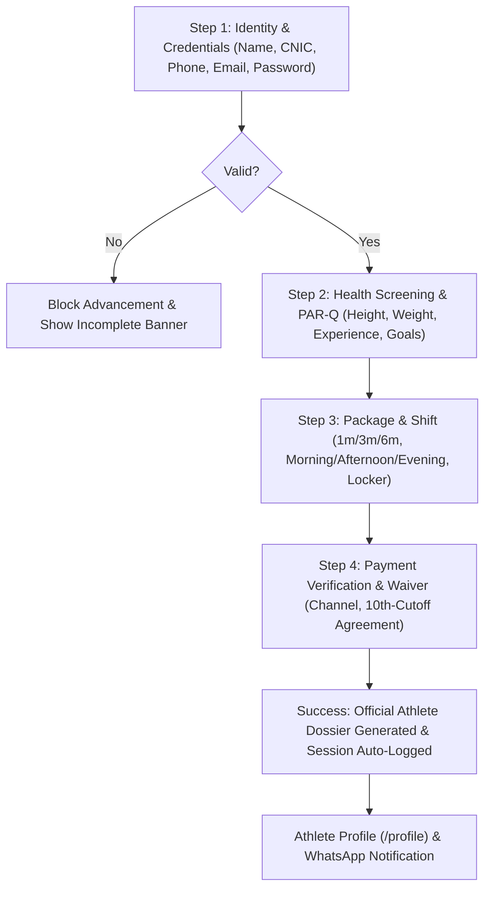

# GymFlow &mdash; Public Website & Landing Page Overview
## Premier Athletic Facility Operating System & Member Portal

> **Document Purpose:**  
> This document defines the commercial positioning, customer-facing value proposition, athletic visual identity, and page-by-page layout for the public marketing website and member experience of **GymFlow**.  
> It reflects all design iterations, including the **Nexora Dark Athletic SaaS theme**, authentic strength gym content, 100% Capital Case typography, unified Sign-Up & Admission flow, and 1-on-1 Coaching application system.

---

## 1. Commercial Positioning & Value Proposition

### 1.1 What is GymFlow?
GymFlow is the modern athletic facility operating platform and member experience engineered for commercial gyms, strength sanctuaries, boutique fitness studios, and martial arts academies.

Instead of generic SaaS platforms with bloated monthly fees, GymFlow provides:
* **Authentic Strength & Athletic Environment:** Tailored for facilities equipped with Eleiko competition plates, Hammer Strength bays, Olympic lifting platforms, Finnish dry saunas, and cold plunge immersion.
* **Autonomous 24/7 Biometric Turnstiles:** Dynamic offline smartphone turnstile passes and optical gate verification eliminating lost plastic cards.
* **Universal 10th-Cutoff Billing Engine:** Automated monthly fee synchronization with strict cutoff lockout enforcement on delinquent accounts.
* **Integrated Athlete Ecosystem:** Complete member self-service with workout streak tracking, athlete profile dashboards, and 1-on-1 personal coaching applications.

### 1.2 Target Audiences
1. **Gym Visitors & Prospective Athletes:** Discovering training programs, comparing transparent membership tiers (in PKR), applying for 1-on-1 coaching, and completing digital admissions online.
2. **Enrolled Members & Athletes:** Managing their Athlete Profile (`/profile`), tracking training consistency streaks on the Mobile PWA (`/app`), and communicating with coaches.
3. **Gym Owners & Operations Staff:** Monitoring gym floor occupancy, reviewing athlete intake dossiers, broadcasting targeted email announcements, and auditing 10th-cutoff payment ledgers (`/admin`).

---

## 2. Global Public Navigation & Header Architecture

The public header ([`src/components/public-header.tsx`](file:///src/components/public-header.tsx)) is static and identical for all visitors, providing clean public exploration without administrative exposure:

```
[GymFlow. Logo]   Home  |  About  |  Programs  |  Coaching  |  Facilities  |  Memberships  |  Admission  |  Contact   [Log In]  [Sign Up]  [Profile Icon]
```

* **Neutral Public Navigation:** No admin buttons or privileged roles exposed in the public header.
* **Clean Typographical Standards:** Strict Title Case / Capital Case across all links (no forced all-caps).
* **Direct Actions:**
  * **Log In:** Routes to [`/login`](file:///src/app/login/page.tsx) (dedicated athlete & member sign-in).
  * **Sign Up:** Direct shortcut to [`/admission`](file:///src/app/admission/page.tsx) (unified sign-up & admission gateway).
  * **Profile Icon:** Direct access to [`/profile`](file:///src/app/profile/page.tsx) (Athlete Profile Dashboard).
  * **Mobile Drawer:** Responsive slide-out menu with all links and prominent action pills.

---

## 3. Page-by-Page Architectural Breakdown

### 3.1 Marketing Homepage (`/`)

The landing page represents an authentic athletic training facility built for velocity and progressive overload:

#### Section 1: Hero Banner (Above the Fold)
* **Pill Badge:** `"🔥 Flagship Athletic Facility Metropolis HQ is open 24/7 →"`
* **Main Headline:**
  > **The Strength Sanctuary**  
  > **Built for Peak Performance.**
* **Value Subtitle:** *"Olympic-spec Eleiko bumper plates, Hammer Strength bays, expert coaches, and 24/7 automated biometric turnstiles. Transform your raw physical potential."*
* **Dual Fixed-Height CTAs (48px / `h-12`):**
  * `[Start Free Trial →]` (links to `/admission`)
  * `[Book Gym Tour]` (links to `/contact`)
* **Background Visuals:** High-contrast authentic athlete imagery with fluted vertical dark pleats texture overlay and crimson ambient backlighting (`#ff2a2a`).

#### Section 2: Real-Time Floor Metrics (Replaced Excessive QR Codes)
In place of repetitive turnstile QR codes, the hero presents 3 high-impact athletic performance metrics:
1. **Total Iron Moved:** `2.45 M kg` *(32% overload vs last 7 days)*
2. **Workouts Logged:** `18,200+` *(24% attendance vs last 7 days)*
3. **Gym Floor Volume:** `18.6 K Sets` with glowing red SVG area wave sparkline and daily training velocity indicators.

#### Section 3: Complete Athletic Ecosystem & Floor Cockpit
* **Interactive Floor Status:** Real-time indicator ("34 Athletes on Floor Now"), Active Athletes (142), Average Session Length (68 min).
* **Equipment Arsenal Showcase:** Calibrated Eleiko Olympic discs, heavy-duty dumbbell racks up to 60 kg, Watson multi-grip pull-up bays, Concept2 rowers, and Rogue Echo bikes.
* **Daily Tactical Strength Protocol:** Push/Pull/Legs periodization splits with volume load and intensity tags.

#### Section 4: Training Disciplines Preview
High-energy tiles with authentic imagery and intensity badges:
* *Powerlifting & Hypertrophy* (95% Intensity • Led by Sarah Jenkins)
* *Boxing & Strike Combatives* (90% Intensity • Led by Marcus Vance)
* *Cardio Blast & Core Blitz* (85% Intensity • Led by David Cole)

#### Section 5: Transparent Membership Plans (PKR)
* **1 Month Package:** ₨ 8,500 (+ ₨ 1,000 admission fee, standard floor access)
* **3 Month Pro Athlete (Most Popular):** ₨ 22,500 (Free admission, sauna & cold plunge included)
* **6 Month Elite Membership:** ₨ 42,000 (Free admission, dedicated locker included, 2 guest passes/month)

---

### 3.2 Unified Athlete Sign-Up & Admission Gateway (`/admission`)

Sign Up and Admission are combined into one unified, 4-step onboarding flow. Legacy `/register` routes automatically redirect here via server HTTP 307.



#### Step 1: Identity & Account Credentials (Strictly Gated)
* **Form Fields:** Full Legal Name, Father/Guardian Name, CNIC / B-Form Number, Date of Birth, Gender, Blood Group, WhatsApp Mobile Number, Alternate Phone, **Email Address (Login ID)**, **Create Login Password** (with show/hide eye toggle), Residential Address & Sector, City, Emergency Contact Name & Emergency Phone.
* **Validation Enforcement:** Steps 2, 3, and 4 cannot be accessed by clicking or advancing until all required Step 1 fields are verified.

#### Step 2: Physical & Health Screening
* Height (Feet/Inches), Weight (kg), Lifting Experience, Primary Fitness Objective, Medical Condition Checkboxes (Heart, BP, Asthma, Joint Injuries, Surgery), and Dietary/Medical notes.

#### Step 3: Package Selection & Training Shift
* Tier selection (1 Month, 3 Month Pro, 6 Month Elite), Shift window (Morning, Afternoon, Prime Evening), Locker add-on reservation, and Coach Assignment request.

#### Step 4: Payment Method & Mandatory Waivers
* Payment channel selection: EasyPaisa (`0325 9491349`), JazzCash, Cash at Desk, or Bank Transfer (Meezan Bank).
* Mandatory consent: **Strict 10th-of-the-month cutoff lockout policy**, GymFlow code of conduct, and physical exercise liability release.

#### Completion: Official Athlete Dossier Summary
* Replaced raw pass matrix with an **Official Athlete Dossier**: allocated Member ID (e.g. `2026-4`), tier badge, shift confirmation, printable slip, automatic session persistence to `localStorage`, and direct buttons to **"View Athlete Profile"** (`/profile`) and **"Send Confirmation on WhatsApp"**.

---

### 3.3 1-on-1 Personal Coaching Application (`/coaching`)

A dedicated feature allowing members and prospective athletes to apply for direct coach mentorship:
* **Coach Roster Showcase:**
  * **Coach Marcus Vance:** Head of Hypertrophy & Powerlifting (CSCS, 12+ Yrs)
  * **Coach Sarah Jenkins:** Olympic Weightlifting & Combat Prep (USAW L2, 9+ Yrs)
  * **Coach David Cole:** Conditioning & Body Recomposition (EXOS, 8+ Yrs)
  * **Lead Nutritionist Amina Tariq:** Clinical Sports Nutrition (ISSN, 7+ Yrs)
* **2-Step Intake Form:**
  * *Step 1:* Athlete Identity (auto-populated if logged in).
  * *Step 2:* Target Discipline, Coach Preference, Weekly Frequency (2–5 sessions/week), Experience, Shift, and 90-day physical milestones.
* **Live Dossier Spotlight:** Real-time preview of the coach's credentials, free initial consultation notice, and direct WhatsApp desk inquiry.
* **Submission:** Allocates Reference ID (e.g. `COACH-4821`), links to `localStorage`, and generates a pre-formatted WhatsApp intake message.

---

### 3.4 Athlete Profile Dashboard (`/profile`)

Personal command center for enrolled gym members:
* **Athlete Header Hero:** Name, avatar monogram, active athlete pill, email, WhatsApp phone, and Member ID.
* **Editable Dossier:** Inline editing of address, phone, shift, and emergency contacts with instant `localStorage` synchronization.
* **Membership Status Card:** Active package tier, next 10th-of-month cutoff date, 24/7 turnstile access clearance, and 1-tap WhatsApp renewal.
* **1-on-1 Coaching & Mentorship Card:** Shows assigned coach, target goal, session frequency, live review status (`REVIEWING` / `ACTIVE`), and direct **"Message Coach on WhatsApp"** button.
* **Companion App Launcher:** Direct shortcut to launch the Mobile PWA (`/app`).

---

### 3.5 Dedicated Member Login (`/login`)

* **No Admin Switcher:** The "Admin Director" button and role switcher have been completely removed from the form.
* **Dedicated to Athletes:** Form fields for Email Address or Member Code (`2026-4`) + Password.
* **Quick Demo Credentials:** Athlete test credentials only (`moeezahmad.tech@gmail.com` / `password123`).
* **Direct Redirection:** Authenticated members are redirected straight to their **Athlete Profile** (`/profile`).

---

### 3.6 Strict 2-Step Contact & Assessment Form (`/contact`)

* **Step 1:** Name, WhatsApp Mobile, Email Address. Step 1 validation strictly blocks advancement to Step 2 if fields are empty or invalid.
* **Step 2:** Program of interest (Strength, Boxing, Conditioning, Recovery), primary goals, and custom message.
* Direct desk WhatsApp link (`+92 325 9491349`) and Metropolis HQ address details.

---

### 3.7 Executive Admin Operations Suite (`/admin`)

* **Email Broadcast Mock Engine:** Allows gym directors to compose email announcements with audience segmentation filters:
  * `All Members`
  * `Current Members` (active subscriptions)
  * `Old Members` (expired or lapsed memberships)
  * `New Members` (enrolled in the last 30 days)
  * `Selected Members` (manual checkbox multi-select)
* Live recipient counters, subject line input, template selectors, real-time message preview, and dispatch confirmation.
* Executive KPIs: Today's check-ins, current floor occupancy, gross PKR intake, live turnstile relay feed, and member directories.

---

## 4. Visual Identity & Nexora Design System

* **Primary Dark Obsidian:** `#000000` / `#09090b` / `#0f1013`
* **Card & Surface Zinc:** `#121316` / `#18181b` with subtle `border-zinc-900`
* **Crimson Accent Red:** `#ff2a2a` (Buttons, active icons, glowing neon halos)
* **Emerald Green:** `#10b981` (Turnstile clearance, active membership pills, WhatsApp actions)
* **Amber Warning:** `#f59e0b` (10th-cutoff deadlines, pending coach reviews)
* **Strict Casing:** All headers, badges, footers, and buttons adhere strictly to **Title Case / Capital Case**.
* **Footer Spacing:** Generous spacing (`pt-24 pb-20`, grid gaps `gap-12` to `gap-20`) preventing cramped text.
