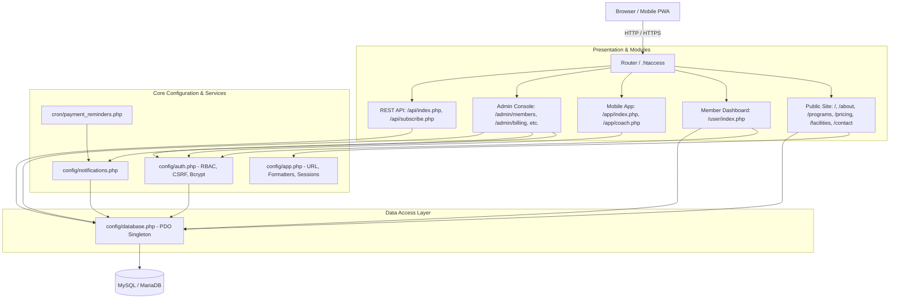
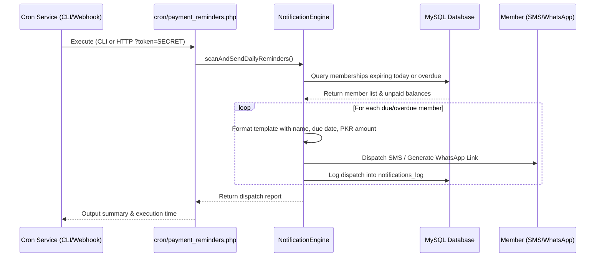

# GymFlow &mdash; System Architecture & Technical Design

This document details the software architecture, design patterns, directory layout, routing mechanics, and security infrastructure of the GymFlow application.

---

## Table of Contents
1. [Architectural Overview](#1-architectural-overview)
2. [Component Architecture Diagram](#2-component-architecture-diagram)
3. [Directory Layout](#3-directory-layout)
4. [Routing & URL Resolution](#4-routing--url-resolution)
5. [Database Architecture & Data Flow](#5-database-architecture--data-flow)
6. [Security Architecture & RBAC](#6-security-architecture--rbac)
7. [Automated Notification & Cron Architecture](#7-automated-notification--cron-architecture)

---

## 1. Architectural Overview

GymFlow utilizes a lightweight **Modular Monolithic MVC-inspired architecture** built in modern native PHP. By eliminating heavy framework dependencies, GymFlow achieves sub-second execution speeds, low memory utilization, and ease of deployment on any standard PHP hosting environment.

The system is partitioned into four major layers:
* **Presentation Layer:** Vanilla PHP templates leveraging Tailwind CSS and responsive micro-interactions for the public website, administrative console, member portal, and mobile PWA.
* **Controller / Routing Layer:** URL rewrite engine (`.htaccess` and `router.php`) directing clean extensionless requests to functional endpoints and views.
* **Business Logic & Service Layer:** Core helper modules (`config/auth.php`, `config/notifications.php`, `config/app.php`) handling authorization, session validation, SMS/WhatsApp templating, and billing cycles.
* **Data Access Layer:** Singleton PDO database connection wrapper (`config/database.php`) executing prepared statements against MySQL/MariaDB with strict transaction isolation.

---

## 2. Component Architecture Diagram



---

## 3. Directory Layout

```
GYM management system/
│
├── .env                         # Local environment configuration (credentials)
├── .env.example                 # Template for environment settings
├── .htaccess                    # Apache URL rewrite rules for clean URLs
├── router.php                   # Built-in PHP server router (.htaccess emulator)
├── schema.sql                   # Complete database schema, indexes & seed data
├── manifest.json                # PWA manifest definition (colors, icons, name)
├── sw.js                        # PWA Service Worker for offline caching
├── index.php                    # Public landing page
├── about.php                    # About us & gym philosophy page
├── programs.php                 # Fitness training programs catalog
├── pricing.php                  # Membership tiers and pricing in PKR
├── facilities.php               # Gym floor, sauna & recovery showcase
├── contact.php                  # Prospect inquiry form & location
├── login.php                    # Unified login screen (Admin, Staff, Member)
├── register.php                 # Self-service member sign-up
├── logout.php                   # Secure session termination handler
├── privacy.php / terms.php      # Legal policies
│
├── admin/                       # Administrative Control Suite (RBAC Protected)
│   ├── index.php                # Master admin dashboard with live KPIs
│   ├── members.php              # Member directory, search, filter & quick actions
│   ├── members-add.php          # Register new gym member form
│   ├── members-edit.php         # Update member profile, plan, or credentials
│   ├── billing.php              # Invoicing hub & 10th cutoff fee reconciliation
│   ├── payments.php             # Transaction audit history and receipts
│   ├── plans.php                # Dynamic membership package CRUD builder
│   ├── messages.php             # Contact form inquiries inbox & resolution
│   ├── attendance.php           # Front desk attendance & turnstile monitor
│   ├── reminders.php            # Messaging & reminder control center
│   └── newsletter.php           # Email subscriber list & broadcast campaigns
│
├── user/                        # Member Self-Service Portal
│   └── index.php                # Member pass, check-in, streak counter & payments
│
├── app/                         # Standalone Mobile Progressive Web App (PWA)
│   ├── index.php                # Mobile app dashboard with QR code access
│   ├── coach.php                # Direct coach messaging & WhatsApp support
│   ├── api.php                  # Mobile JSON endpoints (check-in, coach messages)
│   ├── manifest.json            # Dedicated mobile app manifest
│   ├── sw.js                    # Mobile service worker
│   └── icons/                   # Mobile launcher icon assets
│
├── api/                         # Public REST API Gateway
│   ├── index.php                # Status, active plans, and contact endpoints
│   ├── subscribe.php            # Newsletter subscription endpoint
│   └── attendance.php           # Hardware turnstile integration endpoint
│
├── config/                      # Core Configuration & Services
│   ├── app.php                  # Session initialization, base URL, currency helpers
│   ├── database.php             # Singleton PDO database connector & .env parser
│   ├── auth.php                 # RBAC helpers, CSRF protection, password hashing
│   ├── notifications.php        # Notification engine (SMS/WhatsApp templates)
│   └── schema.sql               # Baseline schema reference
│
├── components/                  # Reusable UI Partials
│   ├── head.php                 # Meta tags, typography, CSS stylesheets
│   ├── header.php               # Public navigation bar & responsive mobile drawer
│   ├── footer.php               # Public footer with quick links & operating hours
│   ├── admin-header.php         # Unified admin header with user profile & breadcrumbs
│   └── admin-sidebar.php        # Collapsible admin navigation menu
│
├── cron/                        # Automated Scheduled Jobs
│   └── payment_reminders.php    # CLI / Webhook daily overdue scanner
│
├── docs/                        # Complete Technical Documentation
│   ├── features.md              # Detailed features and functional capabilities
│   ├── requirements.md          # System, software & hardware requirements
│   ├── architecture.md          # Technical design and architectural documentation
│   ├── database.md              # Database schema dictionary and ER relationships
│   ├── api.md                   # REST API documentation & payload examples
│   └── installation-guide.md    # Local and production installation manual
│
├── scripts/                     # Utility Scripts
│   ├── seed_users.php           # User account synchronization and password seeder
│   └── generate_icons.ps1       # PowerShell icon generator utility
│
└── assets/                      # Static Assets (CSS, JS, Fonts, Images)
```

---

## 4. Routing & URL Resolution

GymFlow enables clean, extensionless URLs across all environments.

### Production (Apache `.htaccess`)
The root `.htaccess` implements conditional rewriting:
1. Skips rewrite for existing physical files or directories.
2. Checks if a matching `.php` file exists and internally rewrites `/about` to `/about.php`.
3. Preserves query string parameters using the `[L,QSA]` flag.

### Local Development (`router.php`)
When running via the PHP built-in server:
```bash
php -S localhost:8080 router.php
```
`router.php` inspects incoming request paths and matches:
* Root `/` &rarr; `index.php`
* Exact `.php` requests &rarr; direct execution
* Extensionless routes &rarr; looks for `$path.php`
* Directory paths &rarr; looks for `$dir/index.php`
* Static assets (CSS, JS, images, SVG, icons) &rarr; served natively with appropriate MIME types.

---

## 5. Database Architecture & Data Flow

* **Singleton Pattern:** `Database::getConnection()` maintains a single active PDO connection across the request lifecycle to minimize connection overhead.
* **Environment Parser:** `loadEnv()` parses `.env` files without requiring external Composer dependencies.
* **Smart Host Resolution:** Strips `http://` or port prefixes from host variables automatically.

---

## 6. Security Architecture & RBAC

### Role-Based Access Control (RBAC)
Role authorization is enforced on all protected endpoints using declarative guard functions:

```php
// Enforce admin/staff access
requireAdmin();

// Enforce authenticated member access
requireLogin();
```

* **Session Validation:** Authenticated identity is maintained in `$_SESSION['user']`.
* **Session Hardening:** Configured with `session.cookie_httponly = 1`, `session.cookie_samesite = 'Lax'`, and session ID regeneration upon successful login.

### Anti-CSRF Token Protection
Mutating actions require and validate a cryptographic token:
```php
// Verification
if (!verifyCSRFToken($_POST['csrf_token'] ?? '')) {
    die("Security token mismatch.");
}
```

---

## 7. Automated Notification & Cron Architecture


