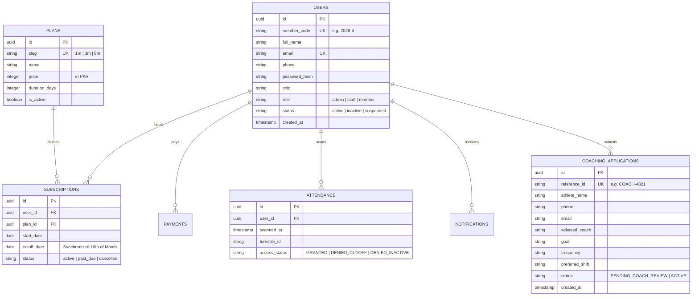

# GymFlow &mdash; System Architecture & Technical Design
## Cloud-Native Serverless Full-Stack Platform for Modern Fitness Facilities

This document details the software architecture, design patterns, directory layout, routing mechanics, and security infrastructure of the modern **GymFlow** application.

---

## Table of Contents
1. [Architectural Overview & Serverless Strategy](#1-architectural-overview--serverless-strategy)
2. [Component Architecture Diagram](#2-component-architecture-diagram)
3. [Next.js App Router Directory Layout](#3-nextjs-app-router-directory-layout)
4. [Routing & URL Resolution Matrix](#4-routing--url-resolution-matrix)
5. [Database Architecture & Drizzle ORM Schema](#5-database-architecture--drizzle-orm-schema)
6. [Access Control, 2D QR Code Generation & Optical Scanner Engine](#6-access-control-2d-qr-code-generation--optical-scanner-engine)
7. [State Management & Session Persistence Strategy](#7-state-management--session-persistence-strategy)
8. [Automated Scheduled Cron Reminders & Background Workers](#8-automated-scheduled-cron-reminders--background-workers)

---

## 1. Architectural Overview & Serverless Strategy

GymFlow is built on a high-performance **Serverless Full-Stack Architecture** engineered for speed, low maintenance, and $0/month operational costs:

* **Next.js 14 (App Router with React 18 / TypeScript):** Combines React Server Components (RSC) for fast server-side rendering with Client Components for dynamic form state.
* **Zero Backend Hosting Fees:** All business logic, turnstile authorization, and database mutations execute via Next.js Route Handlers and Server Actions. No separate Express, PHP, or Python server is needed.
* **Neon Serverless PostgreSQL:** Managed cloud PostgreSQL with PgBouncer connection pooling (`Port 5432`), auto-scaling compute, and database branching on Neon's Free Tier.
* **Drizzle ORM:** Ultra-lightweight TypeScript ORM delivering type-safe queries, zero runtime overhead, and clean modular schema definitions.
* **Standalone Progressive Web App (PWA):** Installable on iOS and Android with custom Service Worker caching (`public/sw.js`) and Web Manifest (`public/manifest.json`), operating with offline turnstile credentials.
* **Optical Camera & Hardware Turnstile Scanner:** Client-side real-time video decoding via `jsQR` with animated laser HUD, Web Audio API sound synthesizers, and USB barcode wedge listener.
* **Vercel Global Edge Network & Neon Free Tier:** Entire platform runs in production with **$0/month infrastructure cost**.

---

## 2. Component Architecture Diagram

```mermaid
graph TD
    Client[Member Smartphone PWA / Front Desk Tablet / Admin Desktop] -->|HTTPS / WSS| EdgeGateway[Vercel Global Edge Network]

    subgraph Next.js 14 Full-Stack Serverless Platform (Zero-Cost Hosting)
        EdgeGateway --> PublicPages["Public Website: /, /about, /programs, /facilities, /pricing, /contact"]
        EdgeGateway --> CoachingIntake["1-on-1 Coaching Intake: /coaching"]
        EdgeGateway --> AdmissionGateway["Unified Sign-Up & Admission Gateway: /admission (Redirects from /register)"]
        EdgeGateway --> AthleteProfile["Athlete Profile Dashboard: /profile"]
        EdgeGateway --> AthleteLogin["Dedicated Member Login: /login"]
        EdgeGateway --> MemberPWA["Standalone Member PWA Shell: /app"]
        EdgeGateway --> OpticalScanner["Live Optical Camera Turnstile Verifier: /scan"]
        EdgeGateway --> AdminCockpit["Executive Admin Management Suite: /admin/* (Includes Email Broadcast Mock)"]
        
        EdgeGateway --> APIRoutes["Next.js Route Handlers: /api/attendance, /api/cron/payment-reminders"]
        
        CronService["Vercel Cron Service (Daily 8 AM)"] -->|Bearer CRON_SECRET| APIRoutes
    end

    subgraph Data Access Layer (TypeScript & Drizzle ORM)
        APIRoutes --> DrizzleEngine["Drizzle ORM Engine (database/index.ts)"]
        AdminCockpit --> DrizzleEngine
        AdmissionGateway --> DrizzleEngine
        
        DrizzleEngine --> NeonPooler["Neon PgBouncer Pooler (Port 5432 - SSL Required)"]
        NeonPooler --> NeonPostgres[("Neon Serverless PostgreSQL (neondb)")]
    end
```

---

## 3. Next.js App Router Directory Layout

```
GYM management system/
│
├── .env                         # Server environment variables (DATABASE_URL, DIRECT_URL)
├── .env.example                 # Environment configuration template
├── package.json                 # Next.js 14, React 18, Drizzle, qrcode, jsqr dependencies
├── tsconfig.json                # TypeScript path aliases (@/* -> src/* and ./*)
├── drizzle.config.ts            # Drizzle ORM migration configuration
├── next.config.mjs              # Next.js runtime configuration
├── tailwind.config.ts           # Athletic obsidian & brand-red design tokens
│
├── public/                      # Static assets & PWA configuration
│   ├── images/                  # Authentic athletic photography & official brand logos
│   │   ├── logo.png             # Official GymFlow horizontal brand logo
│   │   ├── app_logo.png         # Official PWA squircle app icon
│   │   └── ...                  # Calibrated Eleiko plates & gym equipment imagery
│   ├── manifest.json            # PWA web manifest (start_url: "/app", theme_color: "#000000")
│   └── sw.js                    # Service worker for offline shell caching
│
├── database/                    # Modular Drizzle ORM Database Architecture
│   ├── index.ts                 # Database client initialization with Neon Serverless driver
│   └── schema/                  # Modular PostgreSQL schema definitions
│       ├── users.ts             # User profiles, roles (admin/staff/member), status
│       ├── plans.ts             # Membership packages, pricing in PKR, duration
│       ├── subscriptions.ts     # Active/expired member subscriptions & 10th cutoff dates
│       ├── payments.ts          # Financial ledgers, multi-channel payment records
│       ├── attendance.ts        # Turnstile scan logs, gate access status
│       ├── notifications.ts     # System alerts and WhatsApp reminder logs
│       ├── messages.ts          # Lead capture inquiries and contact messages
│       ├── newsletter.ts        # Newsletter subscribers and campaigns
│       └── index.ts             # Schema index & Drizzle relational entity definitions
│
├── src/
│   ├── components/              # Shared Reusable UI Components
│   │   ├── public-header.tsx    # Responsive static header with navigation & auth actions
│   │   ├── public-footer.tsx    # Generously padded footer with operating hours & social links
│   │   ├── admin-sidebar.tsx    # Collapsible dark obsidian admin navigation sidebar
│   │   ├── real-qr-code.tsx     # High-contrast Level H 2D QR code generator with PNG download
│   │   └── pwa-register.tsx     # Client component registering Service Worker (sw.js)
│   │
│   └── app/                     # Next.js App Router
│       ├── layout.tsx           # Global root layout (Teko & Plus Jakarta Sans, dark mode)
│       ├── globals.css          # Tailwind base, dark obsidian scrollbars & keyframes
│       ├── page.tsx             # Public marketing landing page (authentic strength gym)
│       ├── about/page.tsx       # Gym philosophy, certified coach roster, and legacy
│       ├── programs/page.tsx    # Specialized training disciplines with direct coach links
│       ├── coaching/page.tsx    # 1-on-1 Personal Coaching Intake & Coach Roster Showcase
│       ├── facilities/page.tsx  # 4-zone facility tour (Olympic Iron, Dumbbells, Sauna)
│       ├── pricing/page.tsx     # Transparent PKR packages (₨ 8,500 / 22,500 / 42,000)
│       ├── contact/page.tsx     # 2-step validated inquiry form (Step 1 strictly enforced)
│       ├── admission/page.tsx   # Unified 4-Step Sign Up & Admission Gateway with Password
│       ├── register/page.tsx    # Server-level HTTP 307 redirect directly to /admission
│       ├── login/page.tsx       # Dedicated Athlete / Member sign-in portal
│       ├── profile/page.tsx     # Athlete Profile Dashboard (Dossier, Status, Coaching)
│       ├── app/page.tsx         # Standalone Mobile PWA (streaks, pass, in-app auth)
│       ├── scan/page.tsx        # Live Optical Camera & Barcode Turnstile Gate Scanner
│       │
│       ├── admin/               # Executive Admin Management Suite
│       │   ├── page.tsx         # Central KPI Command Center & Email Broadcast Mock Section
│       │   ├── members/         # Member Directory, search, and status controls
│       │   ├── members-add/     # Fast 3-step counter member registration
│       │   ├── admissions/      # Pending admission applications & dossier review
│       │   ├── billing/         # 10th-cutoff payment ledgers, multi-channel audit
│       │   ├── attendance/      # Live gate scan stream, hardware turnstile health
│       │   ├── plans/           # Membership package builder and pricing CRUD
│       │   └── messages/        # Prospect inquiry inbox and WhatsApp actions
│       │
│       └── api/                 # Serverless Route Handlers
│           ├── attendance/      # GET & POST turnstile verification and logging
│           └── cron/            # Scheduled 10th-cutoff payment reminder worker
│
└── docs/                        # Complete technical and design documentation
```

---

## 4. Routing & URL Resolution Matrix

All routes are clean, secure, and resolved automatically by the Next.js App Router:

| URL Route | Render Strategy | Primary Audience | Key Responsibilities |
| :--- | :--- | :--- | :--- |
| `/` | SSR / Edge | Public Visitors | Hero with authentic gym metrics, floor volume sparkline, equipment bays, pricing, lead form. |
| `/programs` | SSR / Edge | Public Visitors | Disciplines showcase with "Apply for 1-on-1 Coaching" buttons per coach. |
| `/coaching` | Client Component | Athletes / Prospects | Coach roster showcase, 2-step coaching intake wizard, live spotlight, WhatsApp dispatch. |
| `/admission` | Client Component | Prospective Athletes | Unified Sign Up & Admission, Step 1 strict validation, password setup, official Athlete Dossier. |
| `/register` | Server Redirect | Prospective Athletes | Instant HTTP 307 redirect forwarding users straight to `/admission`. |
| `/login` | Client Component | Enrolled Members | Dedicated member authentication (email/code + password), routes to `/profile`. |
| `/profile` | Client Component | Enrolled Members | Athlete Profile Dashboard: editable dossier, active tier, 10th cutoff, 1-on-1 coaching status. |
| `/contact` | Client Component | Public Visitors | 2-step validated inquiry form (Step 1 strictly enforced), WhatsApp desk integration. |
| `/pricing` | SSR / Edge | Public Visitors | Standardized packages in PKR with 10th-cutoff policy FAQ. |
| `/facilities` | SSR / Edge | Public Visitors | Tour of Olympic lifting bays, dumbbell bays, Finnish saunas, and cold plunge. |
| `/about` | SSR / Edge | Public Visitors | Facility philosophy, coaching ethos, and Metropolis history. |
| `/app` | Standalone PWA | Active Members | Mobile app interface, offline 2D QR pass, streaks ("🔥 14-Day Streak"), in-app login modal. |
| `/scan` | Client Component | Front Desk Staff | Webcam/tablet optical scanner, jsQR decoding, Web Audio chimes, barrier relay simulator. |
| `/admin` | Client Component | Directors / Staff | Executive cockpit, live occupancy, and Email Broadcast Mock Engine with member filters. |
| `/admin/members` | Client Component | Reception Staff | Fast CNIC/Code search, turnstile lockout toggles, dossier inspection. |
| `/admin/billing` | Client Component | Accountants | Universal 10th-cutoff tracking, "+ Record Payment" modal, multi-channel receipts. |

---

## 5. Database Architecture & Drizzle ORM Schema

The database is deployed on **Neon Serverless PostgreSQL** via **Drizzle ORM**:



---

## 6. Access Control, 2D QR Code Generation & Optical Scanner Engine

1. **Member Pass Generation:** Rendered via [`src/components/real-qr-code.tsx`](file:///src/components/real-qr-code.tsx) using the `qrcode` library with Level H error correction (allows up to 30% damage/smudging without read errors).
2. **Offline Resilience:** Service Workers (`public/sw.js`) cache the pass data and assets locally, allowing athletes to display their valid pass in gym basements without cellular connection.
3. **Optical Camera Scanner:** Implemented in [`src/app/scan/page.tsx`](file:///src/app/scan/page.tsx) using `jsQR`. It captures webcam frames via `requestAnimationFrame` at 60 FPS, decodes the QR string, checks subscription clearance, and emits Web Audio synthesizer sound waves (880Hz / 1320Hz for granted, 220Hz for denied).

---

## 7. State Management & Session Persistence Strategy

1. **Client Session Persistence:** When a member logs in or submits their admission application, their session is cached in `localStorage` under `gymflow_current_user`.
2. **Coaching Application Sync:** Coaching requests submitted on `/coaching` are persisted under `gymflow_coaching_application` and immediately reflected in the Athlete Profile Dashboard (`/profile`).
3. **Profile Updates:** Inline profile updates on `/profile` update both the active React state and `localStorage`, providing immediate, zero-latency persistence.

---

## 8. Automated Scheduled Cron Reminders & Background Workers

* **Route:** `/api/cron/payment-reminders`
* **Trigger:** Vercel Cron scheduled daily at `08:00 UTC` with `Bearer CRON_SECRET` authentication.
* **Logic:**
  1. Identifies members whose 10th-cutoff date is approaching within 3 days, 1 day, or overdue.
  2. Generates system notifications and flags delinquent accounts.
  3. Updates turnstile gate clearance flags to automatically prevent unpaid entrance.
