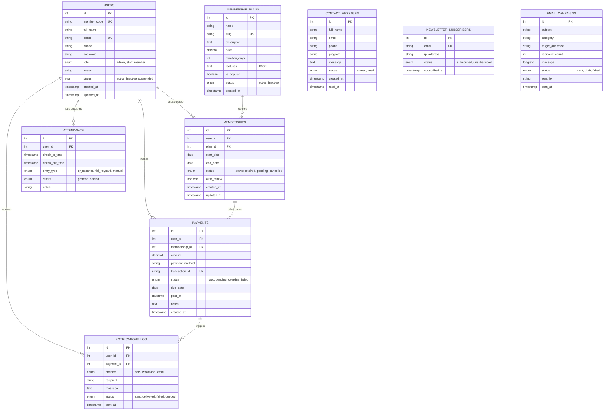

# GymFlow &mdash; Database Schema & Data Dictionary

This document provides a complete reference for the GymFlow relational database schema, table structures, column definitions, constraints, relationships, indexes, and seed datasets.

---

## Table of Contents
1. [Database Overview](#1-database-overview)
2. [Entity-Relationship Diagram (ERD)](#2-entity-relationship-diagram-erd)
3. [Table Data Dictionary](#3-table-data-dictionary)
   - [users](#1-users)
   - [membership_plans](#2-membership_plans)
   - [memberships](#3-memberships)
   - [payments](#4-payments)
   - [attendance](#5-attendance)
   - [notifications_log](#6-notifications_log)
   - [contact_messages](#7-contact_messages)
   - [newsletter_subscribers](#8-newsletter_subscribers)
   - [email_campaigns](#9-email_campaigns)
4. [Default Seed Data & User Credentials](#4-default-seed-data--user-credentials)
5. [Status State Machines & Lifecycles](#5-status-state-machines--lifecycles)
6. [Indexing & Query Optimization](#6-indexing--query-optimization)

---

## 1. Database Overview

* **Engine:** MySQL 5.7+ / MariaDB 10.3+ / MySQL 8.0+
* **Storage Engine:** InnoDB (Strict ACID compliance & Foreign Key enforcement)
* **Default Character Set:** `utf8mb4`
* **Default Collation:** `utf8mb4_unicode_ci`
* **Currency Standard:** Pakistani Rupee (`PKR`)

---

## 2. Entity-Relationship Diagram (ERD)



---

## 3. Table Data Dictionary

### 1. `users`
Stores user records for administrators, gym staff, coaches, and gym members.

| Column | Type | Constraints | Description |
| :--- | :--- | :--- | :--- |
| `id` | `INT` | PRIMARY KEY, AUTO_INCREMENT | Unique user identifier |
| `member_code` | `VARCHAR(30)` | UNIQUE, NOT NULL | Alphanumeric member ID (e.g., `2026-1`) |
| `full_name` | `VARCHAR(100)` | NOT NULL | Member or administrator full name |
| `email` | `VARCHAR(150)` | UNIQUE, NOT NULL, INDEX | Primary email used for login |
| `phone` | `VARCHAR(30)` | NULL | Contact phone number for SMS/WhatsApp |
| `password` | `VARCHAR(255)` | NOT NULL | Bcrypt hashed password |
| `role` | `ENUM` | NOT NULL, DEFAULT `'member'`, INDEX | User role: `'admin'`, `'staff'`, `'member'` |
| `avatar` | `VARCHAR(255)` | NULL | Path to user profile photo |
| `status` | `ENUM` | NOT NULL, DEFAULT `'active'`, INDEX | Account status: `'active'`, `'inactive'`, `'suspended'` |
| `created_at` | `TIMESTAMP` | DEFAULT CURRENT_TIMESTAMP | Registration timestamp |
| `updated_at` | `TIMESTAMP` | ON UPDATE CURRENT_TIMESTAMP | Last profile modification timestamp |

---

### 2. `membership_plans`
Defines available membership packages, pricing in PKR, and inclusive perks.

| Column | Type | Constraints | Description |
| :--- | :--- | :--- | :--- |
| `id` | `INT` | PRIMARY KEY, AUTO_INCREMENT | Unique plan ID |
| `name` | `VARCHAR(100)` | NOT NULL | Name of the plan (e.g., "3 Month Package") |
| `slug` | `VARCHAR(100)` | UNIQUE, NOT NULL | URL-friendly identifier (e.g., "3-months") |
| `description` | `TEXT` | NULL | Marketing overview of plan benefits |
| `price` | `DECIMAL(10,2)`| NOT NULL | Price in Pakistani Rupees (PKR) |
| `duration_days`| `INT` | NOT NULL, DEFAULT `30` | Subscription validity duration |
| `features` | `TEXT` | NULL | JSON string array of included features |
| `is_popular` | `TINYINT(1)` | DEFAULT `0` | Flag to display "Most Popular" badge |
| `status` | `ENUM` | DEFAULT `'active'` | Availability: `'active'`, `'inactive'` |
| `created_at` | `TIMESTAMP` | DEFAULT CURRENT_TIMESTAMP | Creation timestamp |

---

### 3. `memberships`
Links users to their active and historical subscription plans.

| Column | Type | Constraints | Description |
| :--- | :--- | :--- | :--- |
| `id` | `INT` | PRIMARY KEY, AUTO_INCREMENT | Unique subscription record ID |
| `user_id` | `INT` | FOREIGN KEY &rarr; `users(id)` ON DELETE CASCADE | Associated gym member |
| `plan_id` | `INT` | FOREIGN KEY &rarr; `membership_plans(id)` ON DELETE CASCADE | Associated membership plan |
| `start_date` | `DATE` | NOT NULL | Date subscription started |
| `end_date` | `DATE` | NOT NULL | Date subscription expires |
| `status` | `ENUM` | DEFAULT `'active'`, INDEX | State: `'active'`, `'expired'`, `'pending'`, `'cancelled'` |
| `auto_renew` | `TINYINT(1)` | DEFAULT `1` | Automatic renewal status flag |
| `created_at` | `TIMESTAMP` | DEFAULT CURRENT_TIMESTAMP | Creation timestamp |
| `updated_at` | `TIMESTAMP` | ON UPDATE CURRENT_TIMESTAMP | Modification timestamp |

---

### 4. `payments`
Auditable record of membership fee collections, due dates, and transactions.

| Column | Type | Constraints | Description |
| :--- | :--- | :--- | :--- |
| `id` | `INT` | PRIMARY KEY, AUTO_INCREMENT | Unique invoice ID |
| `user_id` | `INT` | FOREIGN KEY &rarr; `users(id)` ON DELETE CASCADE | Member paying the fee |
| `membership_id`| `INT` | FOREIGN KEY &rarr; `memberships(id)` ON DELETE SET NULL | Related membership subscription |
| `amount` | `DECIMAL(10,2)`| NOT NULL | Billed amount in PKR |
| `payment_method`| `VARCHAR(50)` | DEFAULT `'Card'` | Method: Cash, Card, JazzCash, EasyPaisa |
| `transaction_id`| `VARCHAR(100)`| UNIQUE, NULL | Transaction reference code |
| `status` | `ENUM` | DEFAULT `'paid'`, INDEX | State: `'paid'`, `'pending'`, `'overdue'`, `'failed'` |
| `due_date` | `DATE` | NULL, INDEX | Cutoff date for fee payment |
| `paid_at` | `DATETIME` | NULL | Timestamp of verified settlement |
| `notes` | `TEXT` | NULL | Administrative front desk comments |
| `created_at` | `TIMESTAMP` | DEFAULT CURRENT_TIMESTAMP | Invoice generation timestamp |

---

### 5. `attendance`
Check-in records captured via the mobile app, web portal, or front desk.

| Column | Type | Constraints | Description |
| :--- | :--- | :--- | :--- |
| `id` | `INT` | PRIMARY KEY, AUTO_INCREMENT | Access log ID |
| `user_id` | `INT` | FOREIGN KEY &rarr; `users(id)` ON DELETE CASCADE | Member entering the facility |
| `check_in_time`| `TIMESTAMP` | DEFAULT CURRENT_TIMESTAMP | Entry time |
| `check_out_time`|`TIMESTAMP` | NULL | Exit time (optional) |
| `entry_type` | `ENUM` | DEFAULT `'qr_scanner'` | Method: `'qr_scanner'`, `'rfid_keycard'`, `'manual'` |
| `status` | `ENUM` | DEFAULT `'granted'` | Result: `'granted'`, `'denied'` |
| `notes` | `VARCHAR(255)`| NULL | Front desk notes |

---

### 6. `notifications_log`
Tracks automated payment reminders and transactional messages.

| Column | Type | Constraints | Description |
| :--- | :--- | :--- | :--- |
| `id` | `INT` | PRIMARY KEY, AUTO_INCREMENT | Log ID |
| `user_id` | `INT` | FOREIGN KEY &rarr; `users(id)` ON DELETE CASCADE | Targeted member |
| `payment_id` | `INT` | FOREIGN KEY &rarr; `payments(id)` ON DELETE SET NULL | Associated payment reminder |
| `channel` | `ENUM` | DEFAULT `'sms'` | Channel: `'sms'`, `'whatsapp'`, `'email'` |
| `recipient` | `VARCHAR(100)`| NOT NULL | Phone number or email address |
| `message` | `TEXT` | NOT NULL | Rendered message text |
| `status` | `ENUM` | DEFAULT `'sent'` | State: `'sent'`, `'delivered'`, `'failed'`, `'queued'` |
| `sent_at` | `TIMESTAMP` | DEFAULT CURRENT_TIMESTAMP, INDEX | Timestamp message was dispatched |

---

### 7. `contact_messages`
Stores customer inquiries submitted through the public contact form and mobile coach requests.

| Column | Type | Constraints | Description |
| :--- | :--- | :--- | :--- |
| `id` | `INT` | PRIMARY KEY, AUTO_INCREMENT | Message inquiry ID |
| `full_name` | `VARCHAR(100)` | NOT NULL | Prospect or member name |
| `email` | `VARCHAR(150)` | NOT NULL | Email address |
| `phone` | `VARCHAR(50)` | NULL | Contact phone number |
| `program` | `VARCHAR(100)` | NULL | Selected training program of interest |
| `message` | `TEXT` | NOT NULL | Inquiry content |
| `status` | `ENUM` | DEFAULT `'unread'`, INDEX | Inquiry state: `'unread'`, `'read'` |
| `created_at` | `TIMESTAMP` | DEFAULT CURRENT_TIMESTAMP, INDEX | Submission timestamp |
| `read_at` | `TIMESTAMP` | NULL | Timestamp marked as read |

---

### 8. `newsletter_subscribers`
Tracks public newsletter subscriptions.

| Column | Type | Constraints | Description |
| :--- | :--- | :--- | :--- |
| `id` | `INT` | PRIMARY KEY, AUTO_INCREMENT | Subscriber ID |
| `email` | `VARCHAR(255)` | UNIQUE, NOT NULL, INDEX | Subscriber email |
| `ip_address` | `VARCHAR(45)` | NULL | Client IP address |
| `status` | `ENUM` | DEFAULT `'subscribed'`, INDEX | State: `'subscribed'`, `'unsubscribed'` |
| `subscribed_at`|`TIMESTAMP` | DEFAULT CURRENT_TIMESTAMP | Subscription timestamp |

---

### 9. `email_campaigns`
Broadcast campaigns sent to subscribers or gym members.

| Column | Type | Constraints | Description |
| :--- | :--- | :--- | :--- |
| `id` | `INT` | PRIMARY KEY, AUTO_INCREMENT | Campaign ID |
| `subject` | `VARCHAR(255)` | NOT NULL | Email subject line |
| `category` | `VARCHAR(50)` | DEFAULT `'Promotion'` | Category (e.g., 'Update', 'Promotion') |
| `target_audience`|`VARCHAR(100)`| NOT NULL | Target segment (e.g., 'All Members') |
| `recipient_count`|`INT` | DEFAULT `0` | Number of targeted recipients |
| `message` | `LONGTEXT` | NOT NULL | Campaign HTML or plain text body |
| `status` | `ENUM` | DEFAULT `'sent'` | State: `'sent'`, `'draft'`, `'failed'` |
| `sent_by` | `VARCHAR(100)` | NULL | Sender admin username |
| `sent_at` | `TIMESTAMP` | DEFAULT CURRENT_TIMESTAMP | Dispatch timestamp |

---

## 4. Default Seed Data & User Credentials

The database includes predefined test accounts across all roles:

| Role | Member ID | Email | Password | Default Membership |
| :--- | :--- | :--- | :--- | :--- |
| **Admin** | `2026-1` | `admin@gymflow.com` | `Admin123!` | Management Master |
| **Staff / Coach** | `2026-2` | `staff@gymflow.com` | `Staff123!` | Head Trainer |
| **Member** | `2026-3` | `member@gymflow.com` | `Member123!` | 3 Month Package |
| **Member** | `2026-4` | `moeezahmad.tech@gmail.com` | `password123` | 1 Month Package |
| **Member** | `2026-5` | `alex@gymflow.com` | `password123` | 3 Month Package |

---

## 5. Status State Machines & Lifecycles

### Membership Status Lifecycle
```
[Pending] ──(Fee Paid)──> [Active] ──(Date > end_date)──> [Expired]
    │                        │                               │
    └────(Cancelled)─────────┴─────────(Renewed)─────────────┘
```

### Payment Status Lifecycle
```
[Pending] ──(Confirmed)──> [Paid]
    │
    ├──(Due Date Passed)──> [Overdue] ──(Settled)──> [Paid]
    └──(Card Declined)────> [Failed]
```

---

## 6. Indexing & Query Optimization

Composite and single-column indexes are placed on hot query paths:
* `users`: `idx_email`, `idx_role`, `idx_status` &mdash; ensures instant login checks and role filtering.
* `memberships`: `idx_user_membership (user_id, status)` &mdash; provides $O(1)$ lookups for a member's active plan.
* `payments`: `idx_payment_status`, `idx_due_date` &mdash; accelerates cron overdue scans and financial reporting.
* `attendance`: `idx_user_attendance (user_id, check_in_time)` &mdash; enables fast daily check-in validation and streak counts.
